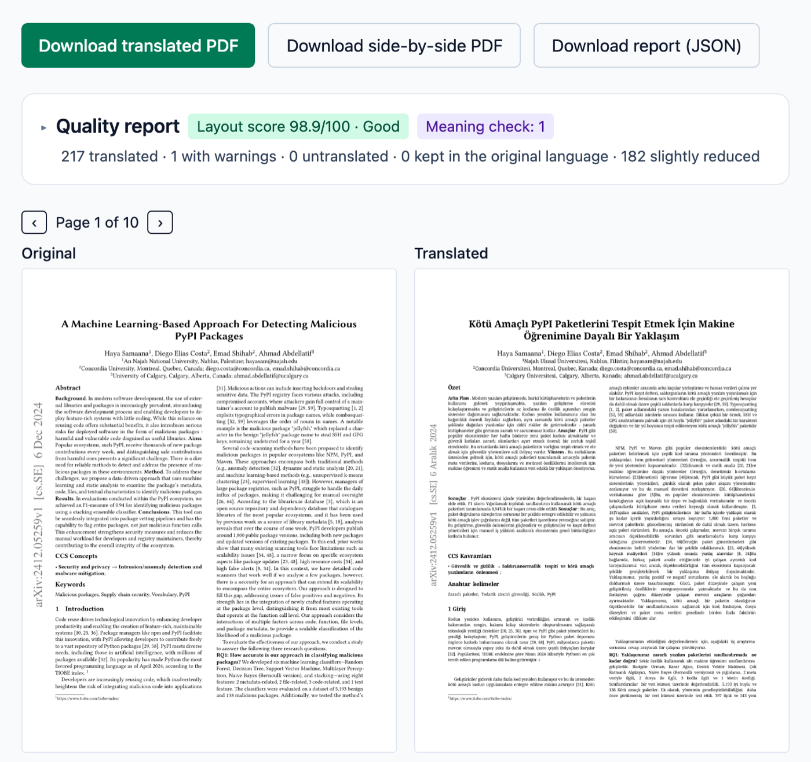
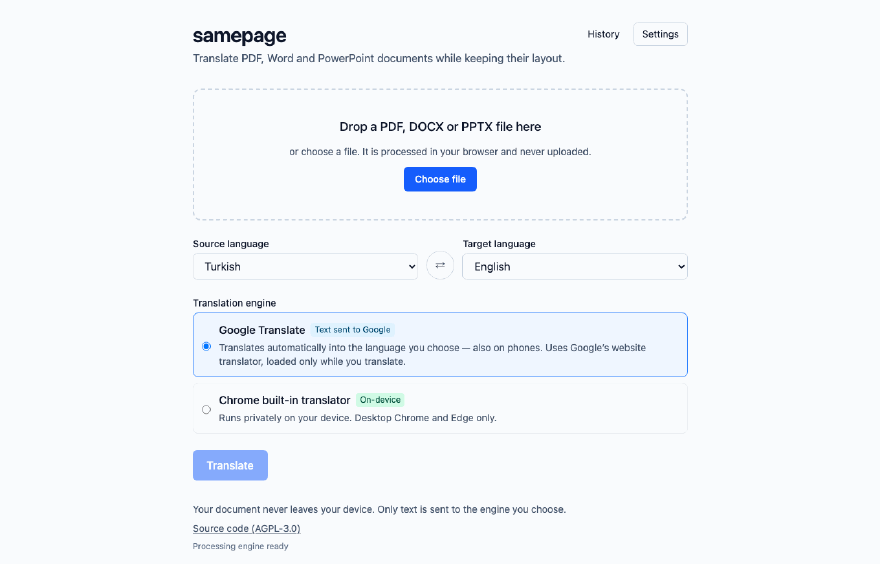
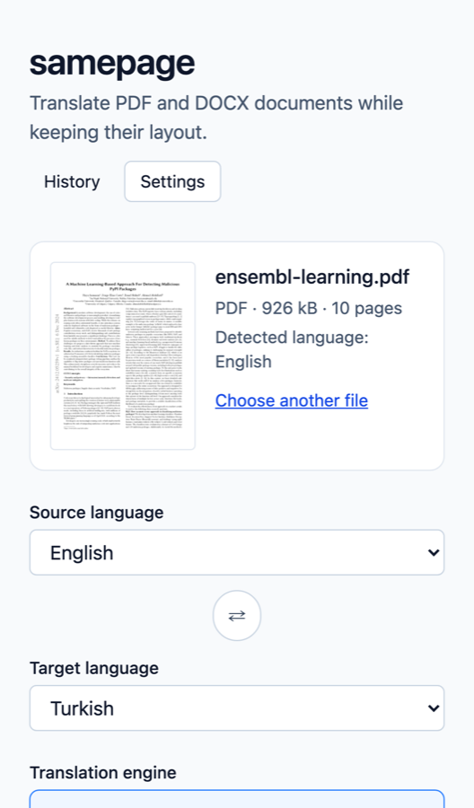
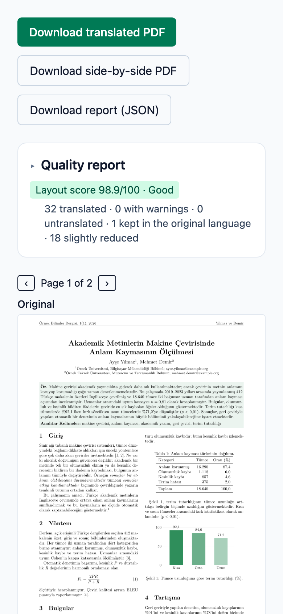

<h1 align="center">samepage</h1>

<p align="center">
  <b>Same page, new language.</b><br>
  Translate a PDF, Word or PowerPoint document in your browser and get the same document back —<br>
  headings, tables, figures, formulas, footnotes and page layout intact.
</p>

<p align="center">
  <a href="https://halilibrahimd27.github.io/samepage/"><b>Open samepage</b></a> ·
  <a href="media/demo-paper.pdf">Demo paper</a> ·
  <a href="#how-it-works">How it works</a> ·
  <a href="#privacy-and-engines">Privacy</a>
</p>

<p align="center">
  <a href="https://halilibrahimd27.github.io/samepage/"></a>
  <a href="https://github.com/halilibrahimd27/samepage/actions/workflows/ci.yml"></a>
  <a href="LICENSE"></a>
</p>

<p align="center">
  
</p>

samepage is built for academics who need their paper in another language — English, German,
Turkish and 14 more — looking like the original, **without uploading it anywhere, without an
account and without paying for an API**, and without a translation that quietly changes what
the paper says.

## Features

- **Same layout.** PDFs are re-typeset into their original boxes with matching fonts. Word and
  PowerPoint files keep every style, table, equation, chart, footnote and speaker note. A
  side-by-side PDF (original | translation) comes with every PDF.
- **Meaning first.** Numbers, units, citations, formulas and identifiers are locked. A meaning
  check translates the result back and flags lost negations, softened or hardened claims
  ("results suggest" → "results reveal") and changed quantifiers ("most" → "all"). You can
  compare every paragraph sentence by sentence, even in a language you do not read.
- **Abstract only.** For journals that ask for a second-language abstract: samepage finds the
  title, abstract and keywords, lets you edit them and translates just those.
- **A glossary from your paper.** Tool names, code and field terms ("confidence interval",
  "randomized controlled trial") are suggested to keep or translate consistently. Nothing is
  applied until you tick it.
- **An honest quality report.** A layout score per page and every compromise listed — nothing is
  dropped or shrunk silently. Correct any paragraph and rebuild the document in place.
- **Scanned papers too.** PDFs without a text layer are read with OCR on your device.
- **Private by design.** No backend, no account, no analytics. Your glossary and the translation
  cache stay in your browser.

## How it works

1. Drop a **PDF** (text-based or scanned), **DOCX** or **PPTX**. The source language is
   detected; choose the target language.
2. Choose **Whole document**, or **Title, abstract and keywords**, and press **Translate**.
3. Read the **quality report**: its summary line gives the score; "needs attention" and
   "meaning check" list what deserves a look.
4. Download the translated document, the side-by-side PDF or the report.

<p align="center">
  
</p>

It works the same on a phone:

<p align="center">
  
  &nbsp;&nbsp;&nbsp;
  
</p>

**Languages:** Turkish, English, German, French, Spanish, Italian, Portuguese, Dutch, Polish,
Czech, Romanian, Hungarian, Swedish, Russian, Ukrainian, Bulgarian and Greek — in any
direction.

## Privacy and engines

samepage is a static site with **no backend**. Your document is opened, analysed and rebuilt
entirely inside your browser; the file itself never leaves your device. Only the text that needs
translating is sent, and only to the engine you choose:

| Engine                           | Where your text goes                                             |
| -------------------------------- | ---------------------------------------------------------------- |
| **Google Translate** (default)   | Google, through Google's website translator. Works on phones.    |
| Chrome built-in translator       | Nowhere — translated on your device (desktop Chrome and Edge)    |
| Advanced: Claude API / local LLM | Anthropic under your own key, or your own computer (`localhost`) |

- **No analytics, no telemetry, no third-party scripts in the app.** Fonts, OCR models and
  WebAssembly are served from this site, and a Content Security Policy limits the app's own
  connections. The one exception is the Google engine: Google's translator script runs in a
  separate, invisible helper page (`translate.html`, same site, its own stricter policy), loaded
  only when you translate with Google. It may set Google's own `googtrans` cookie.
- **The glossary and the translation cache** live only in this browser (IndexedDB) and can be
  cleared in Settings. API keys for the advanced engines are kept in memory unless you choose
  to remember them on this device.

## Quality contract

1. **Meaning first.** Academic text must not drift in meaning. Every translation is validated
   (numbers, citations, formulas, formatting, language) and retried when it fails; the meaning
   check flags what validation cannot see. samepage never shortens or paraphrases body text to
   make it fit the page.
2. **Word and PowerPoint — structure-perfect.** Only the text is swapped. Fixed-size containers
   are repaired (rows grow, text boxes fit their text, slide text uses PowerPoint's own
   shrink-on-overflow) and every repair is reported.
3. **PDF — near-identical layout.** When a translation does not fit, the layout repair engine
   uses free space, careful typography and consistent scaling; as a last resort it keeps a label
   in the original with the translation as a PDF note, or moves the end of a paragraph to
   overflow notes. **Every compromise is reported.**

## How it is tested

Besides unit, golden and end-to-end tests on synthetic documents, samepage is checked against
88 real open-access papers in 17 languages — engineering, mathematics, physics, chemistry,
medicine, nursing, public health, computer science, biology, economics and law — plus round
trips (a paper translated into another language and back) to measure meaning drift. Those
papers are not part of this repository; [`media/demo-paper.pdf`](media/demo-paper.pdf) is a
fictional paper written for the demo, so you can try samepage with it.

## Limitations

- Not supported: right-to-left scripts, vertical CJK, encrypted PDFs, form field values and text
  inside raster images (left untouched and reported).
- OCR errors (rare letters, names, small print) carry into the translation of scanned PDFs, and
  the scanned text is covered with the paper colour rather than removed; hard-to-read pages are
  flagged.
- Inline math in PDFs is re-set in the Noto fonts; display formulas are left untouched.
- Private-use symbols without a Unicode meaning can be lost (reported per page). A page whose
  text cannot be removed without moving the text around it is rewritten from a normalised copy,
  or kept as it is with the translations as PDF notes (reported).
- Very long PDFs (hundreds of pages) need a lot of memory; translate them in page ranges.
- Translation quality depends on the engine. Always review academic text before publishing.

## Development

Requirements: Node.js 24+.

```sh
npm ci
npm run dev          # local dev server
npm run build        # production build (base /samepage/, CSP injected)
npm run test         # unit + property tests
npm run test:golden  # DOCX/PDF golden, identity and layout-fidelity tests
npm run test:e2e     # Playwright end-to-end tests (production build)
npm run fixtures     # regenerate the synthetic corpus (LaTeX needs tectonic)
```

See [CONTRIBUTING.md](CONTRIBUTING.md) for the architecture overview and the rules contributions
must follow. The site is fully static: to self-host, serve the `dist/` folder from any web
server. The CSP is generated from [`build/csp.ts`](build/csp.ts); widen `connect-src` there to
use another translation endpoint.

## License

[AGPL-3.0-only](LICENSE). samepage uses [MuPDF.js](https://mupdf.com/) (AGPL) for PDF
processing. Bundled Noto fonts (including Noto Sans Math) are licensed under the SIL Open Font
License ([public/fonts/OFL.txt](public/fonts/OFL.txt)). OCR uses
[Tesseract](https://github.com/tesseract-ocr/tesseract) through tesseract.js-core and the
`best_int` language models (Apache-2.0), served from this site. The demo paper and all test
documents are synthetic and part of this repository.
